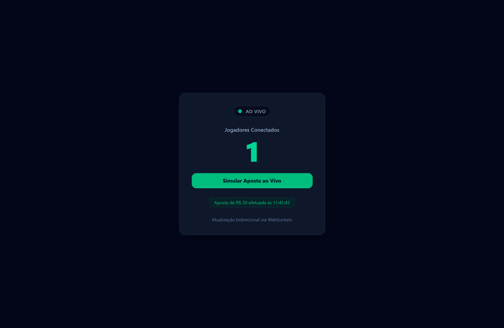

# ⚡ Socket Live Dashboard

Interface em tempo real desenvolvida para monitorizar o fluxo de utilizadores ativos e simular ações de apostas ao vivo através de WebSockets. O projeto foca-se em entregar uma experiência visual fluida, reativa e de baixa latência, ideal para o ecossistema de *iGaming*.

🔗 **Repositorio da API (Backend):** [socket-live-api](https://github.com/lvilela01/socket-live-api)

---

## 📸 Demonstração Visual

<p align="center">
  
</p>

---

## 🚀 Tecnologias e Conceitos

- **[React](https://react.dev/)** — Biblioteca para construção de interfaces reativas
- **[TypeScript](https://www.typescriptlang.org/)** — Tipagem estática para maior segurança no código
- **[Tailwind CSS v4](https://tailwindcss.com/)** — Estilização utilitária e moderna
- **[Socket.IO Client](https://socket.io/docs/v4/client-api/)** — Cliente de comunicação bidirecional em tempo real
- **[Vite](https://vitejs.dev/)** — Build tool ultra-rápida para o frontend

---

## 💡 Destaques de Arquitetura

- **Custom Hook Dedicado (`useLivePlayers`):** Isolamento total da lógica de rede e gestão de eventos do Socket.IO para fora dos componentes visuais.
- **Prevenção de Memory Leaks:** Gestão estrita do ciclo de vida dos eventos utilizando `socket.off()` na função de limpeza do `useEffect`.
- **Conexão Reutilizável:** Instância única do cliente Socket.IO para evitar duplicação desnecessária de conexões WebSockets por aba.
- **Feedback de Estado:** Indicador visual em tempo real com animação pulsante para status de conexão (Ao Vivo / Desconectado).

---

## ⚙️ Como Executar Localmente

### Pré-requisitos
- Node.js instalado (v18 ou superior)
- Servidor backend a correr em `http://localhost:3001` ([instruções no socket-live-api](https://github.com/lvilela01/socket-live-api))

### Passos
1. Clone o repositório:
   ```bash
   git clone [https://github.com/lvilela01/socket-live-web.git](https://github.com/lvilela01/socket-live-web.git)

🌐 **Live Demo:** [https://socket-live-web.vercel.app](https://socket-live-web.vercel.app)
